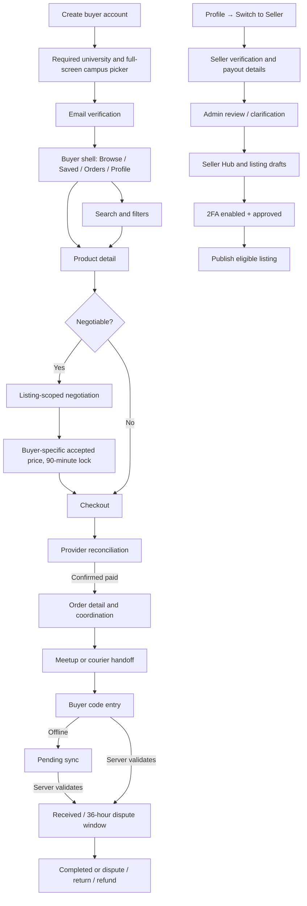

# Soldbay Screen Architecture & Wireframes — Stage 04, Step 08

**Status:** Deferred planning draft. Do not begin screen composition until the Step 06 visual UI kit and component specifications are complete and reviewed.
**Prepared:** 2026-11-06
**Depends on:** Approved PSS and completed/reviewed Stage 04 Steps 01–07, including the visual UI kit/library and component specifications from Step 06.
**Authority:** `docs/architecture.md`, the approved Screen Flow (IA), Admin/Ops Screen Flow (IA), and Feature/Workflow Inventory define behavior. This artifact maps those decisions to screens and does not change product policy.
**Pencil structure:** The documentation canvas will hold approved screen architecture after prerequisites are complete. `design/soldbay-ios.pen` and `design/soldbay-android.pen` are reserved for later wireframes. The twelve premature iOS wireframes created on 2026-11-06 were removed; both platform canvases are currently clear.
**Current execution status:** This document is a draft planning inventory only. It is not an approved screen architecture or authorization to create screens. Step 06 UI kit/library work remains incomplete. The 390 × 844 viewport mentioned below is only a proposal and does not select a device or OS support floor.

## Screen architecture goals

- Give every approved user task a named entry, working surface, state, and return route.
- Keep buyer, seller, Admin, Support, Ops, and courier permissions distinct while sharing task context where the PSS allows it.
- Keep product discovery campus-scoped, communication contextual, and order progress visible from one order record.
- Make the normal path and its pending, blocked, failure, read-only, and recovery states traceable to the PSS.
- Use low-fidelity structures to settle hierarchy and navigation before Step 09 applies high-fidelity visual styling.

## Proposed mobile navigation shell

The product inventory calls for a four-tab app but does not settle tab labels. Proposed labels for review:

| Mode | Main destinations | Contextual routes |
| --- | --- | --- |
| Buyer | **Browse**, **Saved**, **Orders**, **Profile** | Search/filters, product detail, negotiable chat, checkout, order detail, dispute, review, notifications |
| Seller | **Seller Hub**, **Orders**, **Saved**, **Profile** | Listing create/edit, verification, wallet, payout status, product/order chats |

The mode switch remains in Profile, as the approved IA specifies. There is no global chat tab or inbox: messages open from a negotiable listing or a paid order. A notification bell on main destinations opens the notification center and deep-links into the related record. These labels and the exact Seller-mode destination set are design proposals; the existing PSS behavior is unchanged.

## End-to-end navigation map

## Mobile screen inventory

Screen IDs are stable references for future design and acceptance traceability. “States” names the important variations; Step 09 provides the detailed visual treatment.

| ID | Screen / actor | Entry and primary job | Required states and constraints | PSS trace |
| --- | --- | --- | --- | --- |
| AU-01 | Create account — new user | Start signup and capture email/password plus separate Terms, Privacy and 18+ acknowledgements | Empty, validation error, blocked until all required checks are complete | AC-01, AC-36 |
| AU-02 | University and campus — new user | Choose university, then the required full-screen campus picker; confirm selected campus | Campus disabled until university chosen; no skip; registry loading/error; selected campus locked after signup | AC-01, AC-56 |
| AU-03 | Verify email — new user | Enter OTP immediately after account creation | Invalid, expired, resend pending, retry; no app entry until verified | AC-01 |
| AU-04 | Log in / 2FA — returning user | Authenticate with password, then TOTP or unused recovery code when enabled | Field errors, pending, lockout/support route per auth policy | AC-34–36 |
| AU-05 | Forgot password — returning user | Email → OTP → new password → success → Log in | Invalid/expired OTP; password validation; reset does not reactivate account | AC-34 |
| AU-06 | Reactivate account — deactivated user | Sign in and choose whether to reactivate the same account | Decline ends sign-in; accept restores retained history; seller listings stay paused for review | AC-11, AC-22, AC-44 |
| BY-01 | Browse — buyer | View active items for the selected campus, categories and Recently Added feed | Loading, refresh, pagination, empty, stale/offline; sold item remains non-clickable for its one-hour display period | AC-23, AC-46 |
| BY-02 | Search and filters — buyer | Combine keyword, category, price, verified seller, condition and availability; sort price/recency | No results, filter chips, clear filters, stale/offline; no popularity sort | AC-47 |
| BY-03 | Product detail — buyer | Inspect published photos/details, seller status, price and report action; start buy-now | Active, locked/unavailable, self-purchase blocked; negotiable tag; pre-purchase chat only when negotiable | AC-13, AC-23, AC-49, AC-59 |
| BY-04 | Saved listings — buyer | Review wishlist and return to an eligible item | Listing reflects current availability and campus; no lock bypass | AC-48 |
| BY-05 | Negotiation thread — buyer/seller | Discuss a negotiable listing and accept a buyer-specific price | 90-minute accepted-price lock; 24-hour inactive closure/read-only; listing lock; no fixed-price prebuy chat, global inbox, or photo attachment | AC-03–04, AC-13, AC-51 |
| BY-06 | Seller/order chat — buyer/seller | Coordinate an active paid order or read an archived conversation | Active, blocked, archived read-only; scope to order/listing; interruption preserves draft text | AC-25, AC-51–52 |
| CO-01 | Checkout — buyer | Confirm one listing, effective/accepted item price, campus, fulfilment, destination/meeting option, courier fee and total | Listing lock/revalidation, invalid destination, submitting, payment pending, confirmed failure/retry, unknown result reconciliation | AC-05, AC-14, AC-26, AC-37–40, AC-59 |
| OR-01 | Order confirmation — buyer/seller | Show provider-confirmed payment and order reference | Pending provider result is not “paid”; confirmed failure releases reservation | AC-05, AC-14 |
| OR-02 | Order detail/status — buyer/seller | Shared source for current state, timeline, next actor, deadline and order-scoped chat | Preparing, six-hour Ready deadline, four-hour grace, ten-hour auto-cancel/refund, ready, meetup/courier, failed attempt, cancellation | AC-06–09, AC-16–20, AC-24, AC-28–30, AC-38–41 |
| OR-03 | Meetup booking — buyer/seller | Buyer books one seller-posted window at the fixed campus point | No slot, booked, reminder, missed window, 24-hour resolution/replacement | AC-16–17, AC-20, AC-38 |
| OR-04 | Courier coordination — buyer/seller/Ops | Show manual assignment, buyer-preferred campus destination, delivery window, directions, scoped contacts and attempt events | Unassigned/assigned, route change awaits Ops and buyer fee approval, arrival/10-minute attempt; collection is not receipt | AC-24, AC-39–41, AC-55 |
| OR-05 | Handoff code — buyer | Inspect item and enter the six-digit order code | Ready, invalid, retry, offline saved/Pending sync, server validated/Received; courier pickup alone never confirms receipt | AC-07, AC-15, AC-41, AC-45 |
| DS-01 | Open dispute — buyer | Choose an eligible reason, explain issue and attach relevant photo/video within 36 hours | Ineligible/expired, upload progress/error, submitted; exclude change of mind/disclosed flaws | AC-08, AC-18–19, AC-29, AC-45 |
| DS-02 | Dispute status/return — buyer/seller | View response, Support decision, responsibility/cost, required return and one-time return code | Seller 18-hour response; Support 12-hour target; return by original method; 18-hour arrangement period; return pending/refund pending/complete | AC-09, AC-18–20, AC-29–30, AC-43 |
| RV-01 | Seller review / safety report — buyer | Review a final eligible order or report listing/user/message | One 1–5 review plus optional text; report reason/confirmation; no seller rating of buyer; reports do not decide active orders | AC-31, AC-50–51, AC-54 |
| SH-01 | Seller verification — seller | Submit university-format matric, choose-one student proof, store details and payout bank information | Draft, incomplete, private upload, submitted, under review, clarification, rejected, resubmitted; no publish before approval + 2FA | AC-02, AC-12, AC-27, AC-35–36, AC-42 |
| SH-02 | Verification status — seller | Understand decision and next allowed action | Pending, needs clarification with reason, rejected/edit/resubmit, approved, 2FA required | AC-02, AC-27, AC-35–36, AC-42 |
| SH-03 | Seller Hub — seller | Review listing states, orders/sales queue and earnings; start listing or wallet actions | Drafts/active/sold/unlisted; restricted by verification, 2FA or active process; no payout-time promise | AC-23, AC-27, AC-32, AC-37, AC-53 |
| SH-04 | Listing editor — seller | Add photos, title, normal/optional sale price, description, condition and negotiable setting | Draft, validation, private save, ready-to-publish, active lock, sold/archived; edits/delete blocked during any active process | AC-04, AC-13, AC-23, AC-37, AC-53, AC-59 |
| SH-05 | Seller wallet/withdrawal — seller | View proceeds, transaction history, withdrawal and payout status | Held, available, requested, processing, paid, failed with reason and safe retry/correction | AC-06, AC-30, AC-32, AC-43 |
| PF-01 | Profile and settings — buyer/seller | Switch mode, view/edit allowed personal/store fields, access security and help | Username 90-day restriction; store fields editable; bank/personal-detail change through Support request | AC-33–36, AC-53, AC-57–58 |
| PF-02 | Campus-change request — buyer/seller | Submit current→requested campus and reason | Orders unresolved, listings paused, pending, needs info, approved/denied; original-campus history retained | AC-10, AC-21 |
| PF-03 | Help/FAQ and request status — user | Start the defined Support request and read replies/status | Draft, submitted, waiting, response, resolved; account-linked and scoped | AC-33, AC-57 |
| PF-04 | Account security — buyer/seller | Set up TOTP/recovery codes or request loss-of-factor recovery | Optional for buyers; mandatory for seller publish/proceeds; one-time recovery codes; seller reset second reviewer | AC-12, AC-27, AC-35 |
| NT-01 | Notification center — user | Open an event and deep-link to its order/listing/chat/case | Unread/read, empty, loading, destination unavailable; in-app events only as defined | AC-45, AC-52 |
| PR-01 | About/version — user | View release and support links | Version available, load error | AC-60 |

## Staff screen inventory

The approved Admin/Ops IA defines six full-capability screens, each with desktop and mobile-fallback layouts. Shared pattern: queue → detail → allowed action → recorded outcome.

| ID | Screen | Main job and access constraint | PSS / IA trace |
| --- | --- | --- | --- |
| ST-01 | Admin Shell | Desktop sidebar/top bar; mobile top bar/bottom tabs; route by staff task | Admin/Ops IA; AC-55 |
| ST-02 | Seller Verification Review | Queue/filter and detail with only the chosen proof; private matric, store and payout data; approve/reject/request clarification | AC-02, AC-42, AC-55 |
| ST-03 | Moderation | New listings and reported items/messages tabs; report context and auditable action | AC-31, AC-50, AC-54–55 |
| ST-04 | Dispute Mediation | Evidence, seller response, order history, read-only timeline, held funds, outcome and return handling | AC-08–09, AC-18–20, AC-29–30, AC-43, AC-45, AC-55 |
| ST-05 | User Management | Search/profile/verification/order/moderation history; ban/suspend/reinstate with reason | AC-54–55 |
| ST-06 | Campus-Change Review | Queue/current→requested campus/reason; block approval until all relevant orders resolve; pause/restore eligible listings | AC-10, AC-21, AC-55–56 |

Ops courier work and Support cases use assigned responsibilities within the order/mediation surfaces; do not add a second role hierarchy. The desktop shell's exact visual design and responsive pane behavior remain to be worked through here and validated in Step 09.

## Candidate low-fidelity wireframe set — not started

Once prerequisites are complete and this proposal is approved, paired iOS and Android files may use equivalent task/content and a reviewed reference viewport. OS status/network/battery/home/navigation chrome belongs to the OS; it may appear only as neutral device/viewport context. It must not be recreated as fake Soldbay UI. Main destination and contextual navigation should follow the approved platform foundations.

Planned initial low-fidelity set for both platform files:

1. Create account and required acknowledgements (AU-01).
2. University and mandatory full-screen campus selection (AU-02).
3. Email verification before entry (AU-03).
4. Campus-scoped Recently Added browse feed (BY-01).
5. Negotiable product detail and conditional contact (BY-03).
6. Buyer-specific accepted-price conversation (BY-05).
7. Checkout with explicit courier fee and total (CO-01).
8. Order status with courier path and code entry (OR-02/04/05).
9. Offline handoff as Pending sync (OR-05).
10. Eligible dispute reason and media evidence form (DS-01).
11. Seller choose-one proof, store and payout application (SH-01).
12. Seller listing draft fields and negotiable choice (SH-04).

This list is a draft task inventory only. It must be mapped to the completed UI kit and reviewed component library before any visual screen work. It does not approve final tab labels, responsive breakpoints, app technology, or OS support.

## Review and validation boundary

- [x] Buyer, seller, transaction, profile, notification and staff surfaces are mapped to the approved IA/PSS.
- [x] Pending, blocked, error, offline, read-only and deadline states have destinations in the inventory.
- [ ] Owner reviews the proposed four-tab labels/mode destinations and screen inventory.
- [ ] Owner approves Step 08 exit after reviewing both platform wireframe sets.
- [ ] Expand wireframes through compact, large-phone and relevant desktop/mobile-fallback contexts before Step 09.
- [ ] Verify requirement coverage and responsive/accessibility details in Step 10.

**No screen composition is approved or in progress. The screen inventory remains a planning draft until the visual UI kit prerequisite is complete. The prematurely created iOS wireframe frames were deleted; no Android wireframes were created.**
